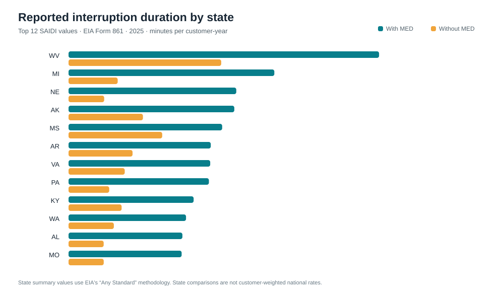

# U.S. Electric Utility Reliability (Power BI)

**Question:** How much do reported state-level interruption metrics vary when major event days (MED) are included versus excluded, and how does utility-level reporting coverage differ?

**Tools:** Power BI, Power Query, DAX, data modeling.

## Data and reproduce

1. Install dependencies: `python -m pip install -r requirements.txt`.
2. Run `python prepare_data.py`. It downloads the official EIA Form 861 2025 archive if needed, cleans the Reliability workbook, and creates `data/state_totals.csv`, `data/utility_reliability.csv`, and `results/analysis_summary.md`.
3. In Power BI Desktop, import both CSVs with the queries in `power_query/`. Create text parameters for the two file paths and name the loaded tables `StateTotals` and `UtilityReliability` to match `measures.dax`. Keep `state` as text; set year and numeric metrics to whole/decimal number types.
4. Create a `State` dimension from the distinct union of states in both tables. Relate `State[state]` one-to-many to each fact table. Add the measures from `measures.dax`. Create a state comparison page and a utility detail page. Put the metric definition and data-coverage caveat on both pages.

The included source snapshot is EIA Form EIA-861, [Reliability schedule, 2025 final data](https://www.eia.gov/electricity/data/eia861/). EIA says utilities report non-momentary interruptions and may use IEEE or other methods. The state totals CSV uses EIA's **Any Standard** state totals. The utility detail CSV retains the IEEE fields. These levels/standards are not directly interchangeable.

## Findings in the current source

The workbook contains 51 state/DC rows. The highest reported state SAIDI with MED was West Virginia at 1,013.2 minutes per year; the lowest was the District of Columbia at 50.3. The highest SAIDI excluding MED was also West Virginia at 498.1; the lowest was the District of Columbia at 33.9. These are EIA state summary values, not population-normalized rates, and reporting methods/coverage vary. See `results/analysis_summary.md` for metrics and missingness counts.

## Power BI report design

- **State comparison:** state slicer, SAIDI/SAIFI with and without MED, customer coverage, and a ranked state table showing both measures.
- **Utility detail:** utility and state slicers, reporting-utility count, IEEE SAIDI/SAIFI measures, and a table that exposes missing values rather than converting them to zero.
- Keep the source year visible and do not present a state-average card as a national customer-weighted rate.

## Interactive preview and native report

Run `python build_preview.py` to create [the interactive browser preview](outputs/reliability_preview.html), a self-contained view of the state comparison. It supports sorting by state or SAIDI values and is generated from the included state CSV. This makes the proposed analysis reviewable without Power BI Desktop, but it is **not** a Power BI report.

The native report still needs to be built in Power BI Desktop and saved as `outputs/electric_reliability.pbix`; add PDF or screenshots after reviewing it. The CSV, DAX, Power Query, analysis note, and HTML preview prepare the data/model and demonstrate the design, but do not replace the `.pbix` deliverable.

## Resume bullet (use after building and reviewing the report)

> Prepared 2025 EIA Form 861 reliability data for Power BI, modeling 51 state/DC summaries and 976 utility-state rows with SAIDI/SAIFI measures for comparisons with and without major event days; retained 224 missing utility SAIDI values as null.
